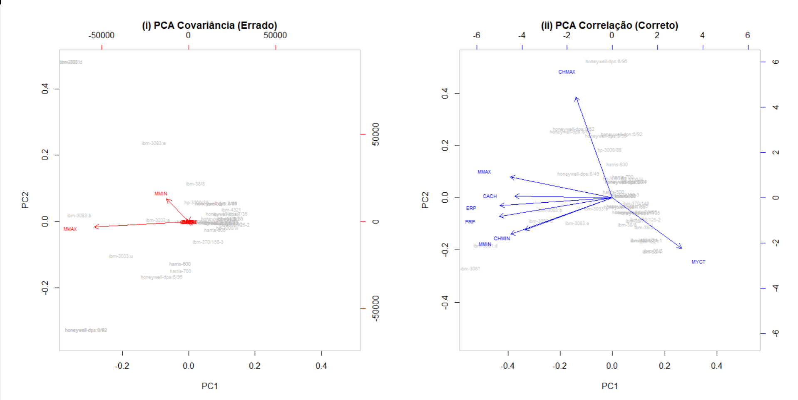
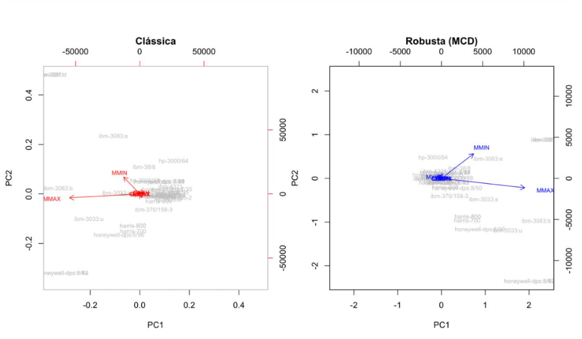

# 📊 Robust PCA on computer hardware data (R)

> **TL;DR:** A statistics study in **R** on a dataset of old computers (memory, cache, cycle time, performance...). We compressed the data with **Principal Component Analysis (PCA)** (5 components keep 97% of the information, and the first 2 have a clear meaning), found the unusual machines (outliers), and showed that classic PCA gets fooled by a single bad data point while **robust PCA** does not. University project for *Statistical Methods for Artificial Intelligence* at Instituto Superior Técnico.

---

## What is this, in plain words?

When a dataset has many columns, it is hard to "see" it. **PCA** is a technique that combines the columns into a few new ones (called *principal components*) that keep most of the information. Here, 5 components keep 97% of the variance, and the first two are easy to interpret:

1. **"Raw capacity and performance"**: memory, cache and performance going up together, opposed to slow cycle times.
2. **"Architecture specialisation"**: separates machines by how their resources are balanced, beyond raw size (details in the report).

The catch: classic statistics (mean, standard deviation, PCA) are very sensitive to **outliers**, values that are far from the rest. One wrong value can change the whole result. **Robust** methods are designed to ignore that kind of value.

## What we did

1. **Exploratory analysis:** compared classic vs. robust summaries (mean vs. winsorized mean vs. median, standard deviation vs. MAD), boxplots and QQ-plots.
2. **Outlier detection:** robust z-scores for single variables and **Mahalanobis distances** (classic and robust MCD) for several variables at once.
3. **Scaling decision:** showed that the variables live on very different scales, so PCA must use the **correlation** matrix (standardised data).
4. **Dimensionality reduction:** kept the components needed to explain at least **95% of the variance** (5 components, 97%) and interpreted the first two.
5. **Stress test:** introduced a contaminated observation and compared **classic PCA vs. robust PCA (MCD)**.

## Results at a glance

**How much information each component keeps** (PCA on the correlation matrix):

| | PC1 | PC2 | PC3 | PC4 | PC5 |
|---|---|---|---|---|---|
| Variance explained | 64.8% | 14.9% | 8.5% | 5.2% | 3.8% |
| Cumulative | 64.8% | 79.7% | 88.2% | 93.4% | **97.2%** |

**Why scaling matters.** On the raw covariance matrix (left), the two memory variables dominate everything and the other arrows collapse onto the origin. On standardised data (right), every variable counts and the trade-off between cycle time (MYCT) and performance/memory becomes visible.



**One bad data point is enough to break classic PCA.** After inserting an inconsistent machine (MMAX = 0.8 with MMIN = 2000), classic PCA (left) is pulled towards that single point and squeezes all other machines near the origin. Robust PCA with the MCD estimator (right) isolates it and keeps the structure of the data.



*Plot titles are in Portuguese: "Clássica" = classic, "Robusta" = robust, "Errado/Correto" = wrong/right.*

## Main findings

- The most extreme machines (the IBM 3081 family) are **not errors**: they are simply the top-performance segment of the sample.
- With one contaminated point, **classic PCA describes the outlier instead of the data**; **robust PCA** stays stable and keeps a meaningful interpretation.

## How to run it

```r
install.packages(c("rrcov", "psych", "car", "ggplot2", "WRS2"))
source("analysis.R")
```

The dataset (`machines`) ships with the `rrcov` package; the study uses the rows from `hp-3000/64` to `ibm-4331-2`.

## Files

| File | Content |
|---|---|
| `analysis.R` | All the R code, organised by question |
| `figures/` | Key plots shown in this README |
| `report.pdf` | Full report with plots, tables and discussion (in Portuguese) |

## Authors

Vasco Caetano and group colleagues, Instituto Superior Técnico.

## Context

- **Course:** Statistical Methods for Artificial Intelligence (Métodos Estatísticos para Inteligência Artificial), Instituto Superior Técnico, University of Lisbon
- Project 1 of 2 (Project 2: [soil-ph-regression-analysis](https://github.com/vascocaetano14/soil-ph-regression-analysis))
- **Stack:** R (rrcov, psych, car, ggplot2, WRS2)
